# WeasyPrint Report

TypeAnvil `v2026.10.1`, beside the Prince reference render (unscored).

| Page | TypeAnvil | Prince |
|---|---|---|
| 1 |  |  |
| 2 |  |  |
| 3 | 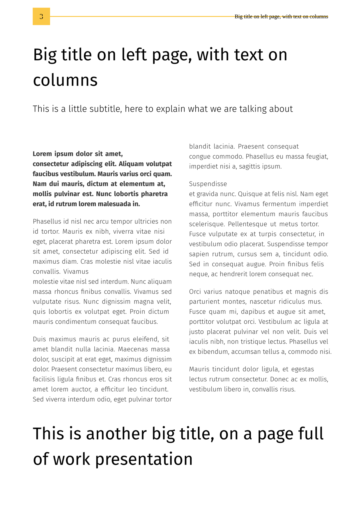 |  |
| 4 | 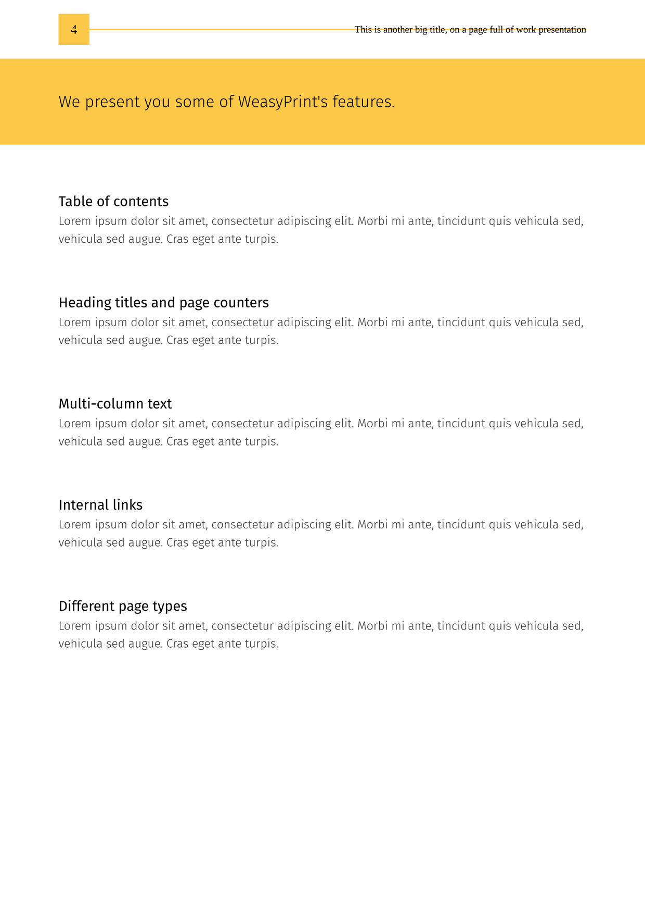 | 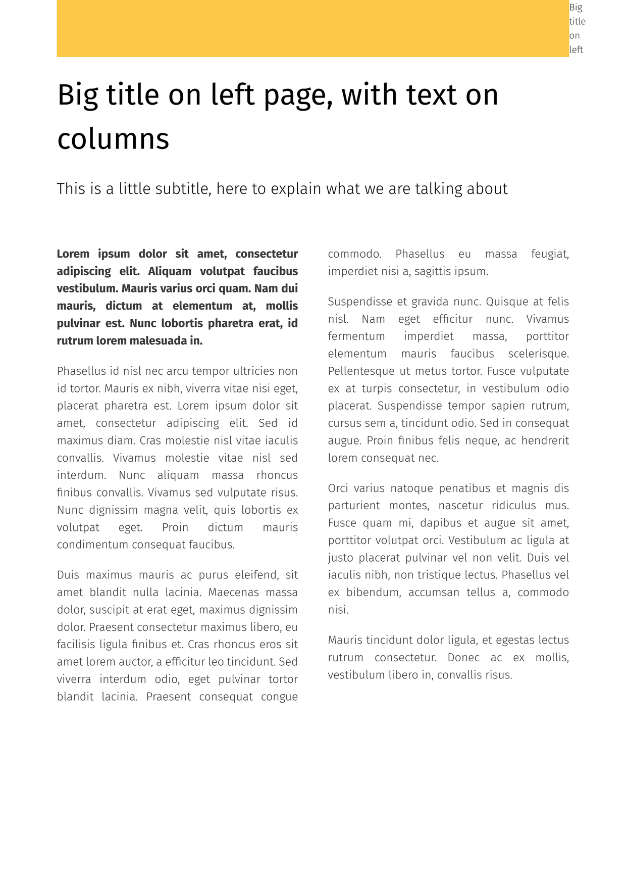 |
| 5 | 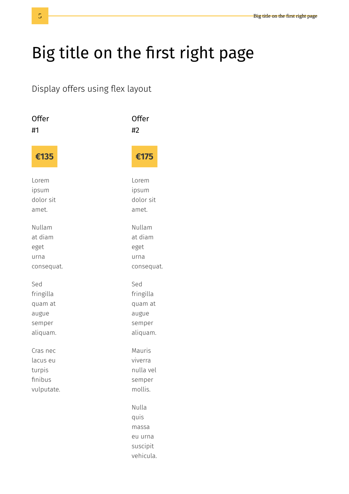 |  |
| 6 | 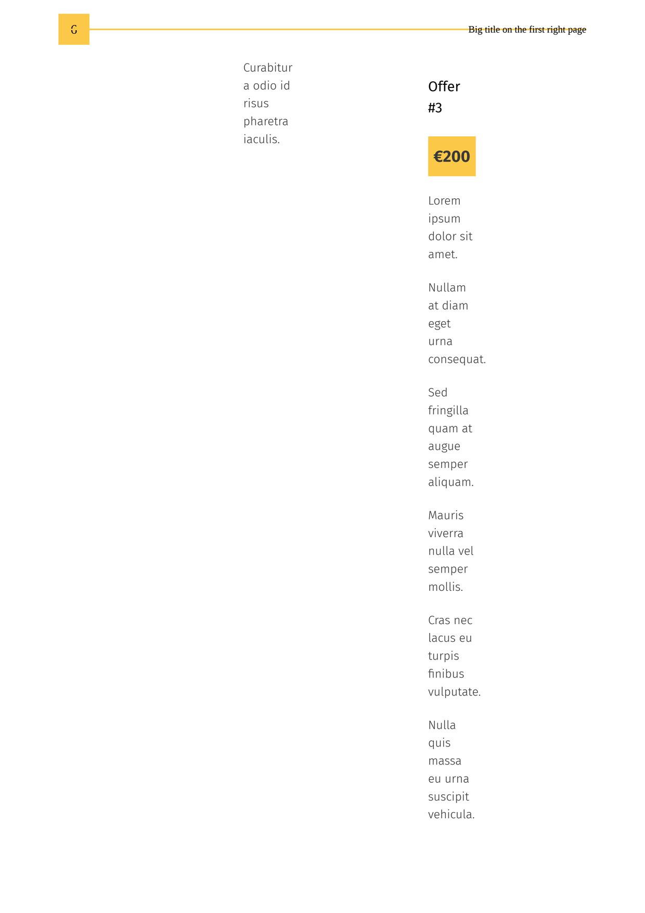 | 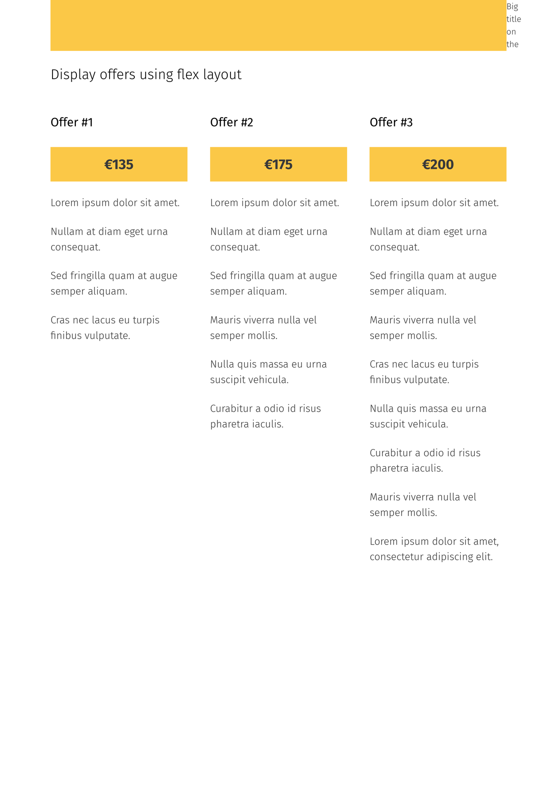 |
| 7 | 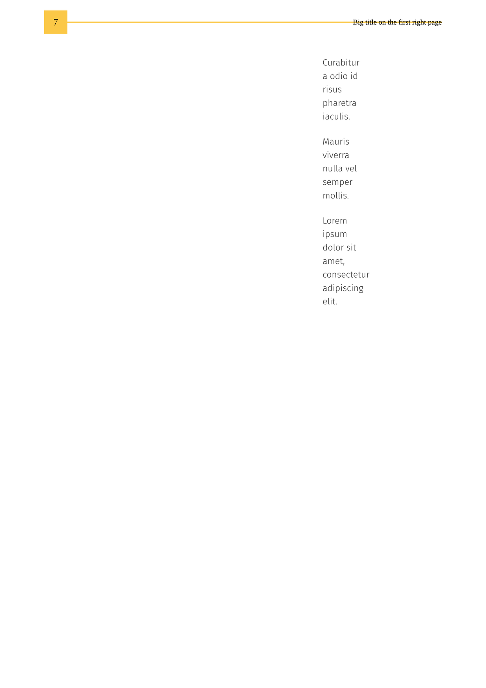 |  |
| 8 | 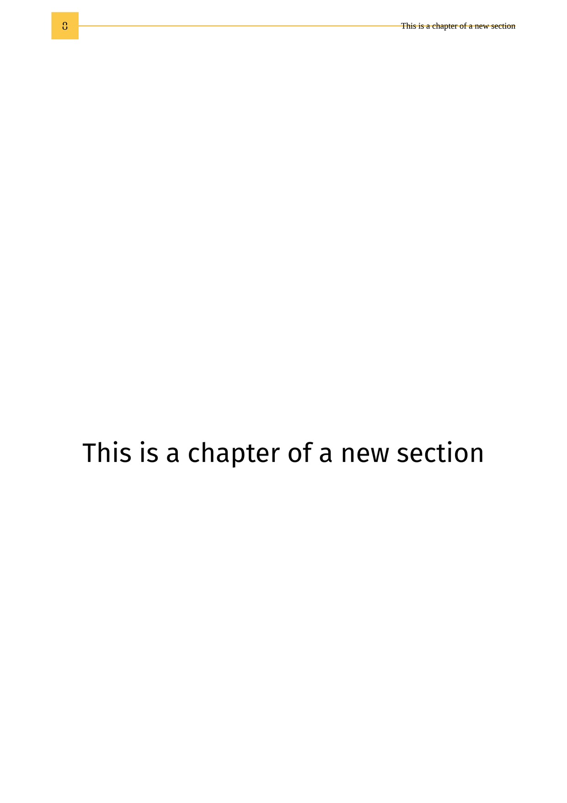 | 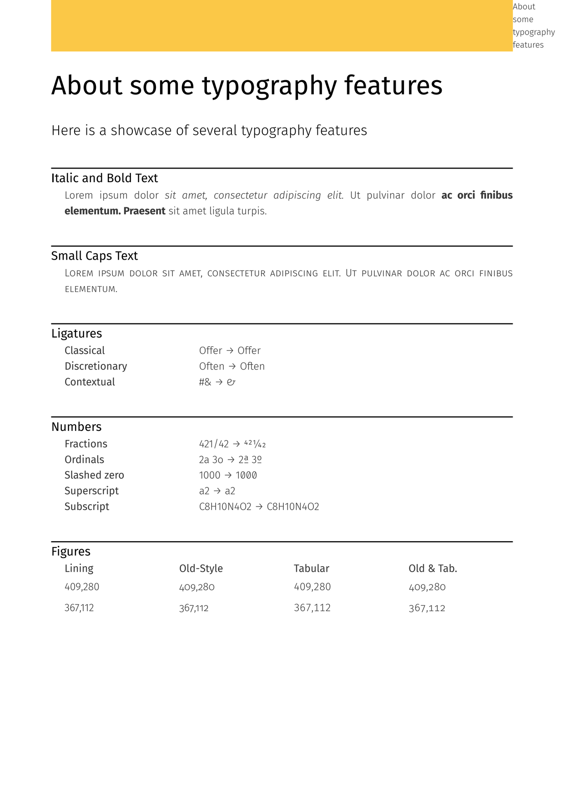 |
| 9 | 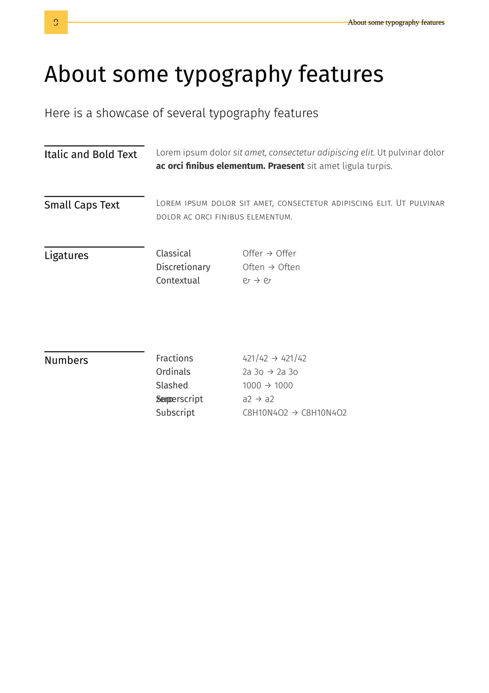 | not rendered |
| 10 | 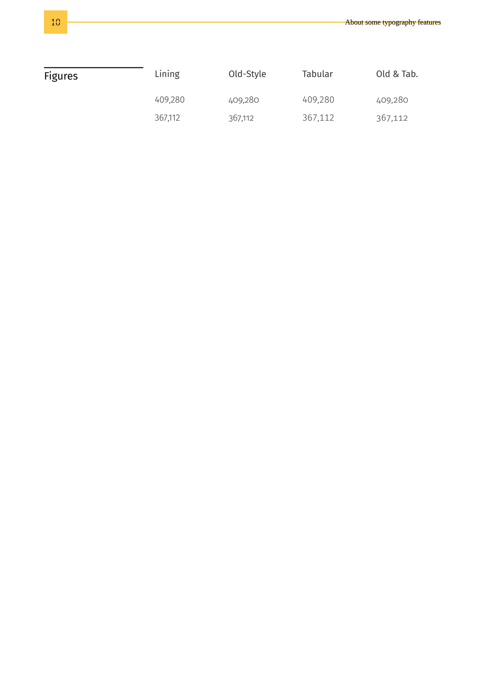 | not rendered |
